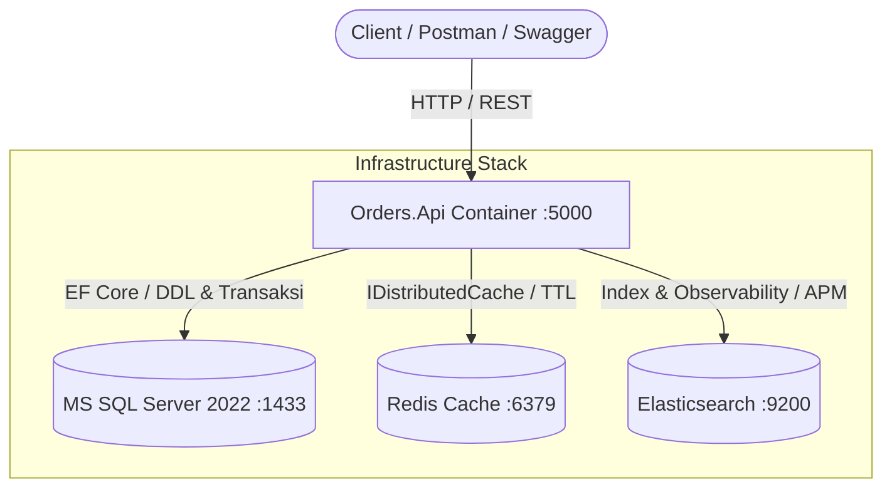

# Panduan Setup, Deployment Docker & Arsitektur Infrastruktur

**Project**: Order Management Service (`MS-Orders`)  
**Framework**: .NET 10 / C# 14 (Clean Architecture & CQRS)  
**Komponen Utama**: SQL Server 2022, Redis Cache, Elasticsearch & Elastic APM  

Dokumentasi ini menjelaskan langkah demi langkah memulai proyek mulai dari *cloning* repositori Git hingga seluruh layanan dan infrastruktur berjalan di kontainer Docker.

---

## 1. Arsitektur Komponen & Infrastruktur

Aplikasi ini mengandalkan 3 komponen infrastruktur utama:



### 1.1 Microsoft SQL Server 2022 (Primary Datastore)
* **Fungsi**: Menyimpan data transaksional pesanan (`Orders`, `OrderDetails`), inventaris produk (`Products`), konfigurasi pesanan (`OrderConfig`), dan log idempotensi (`IdempotencyRecords`).
* **Fitur Utama**:
  * **Optimistic Concurrency Token (`RowVersion`)**: Mencegah *race condition* saat pemotongan stok konkuren dan tabrakan pembaruan status pesanan multi-admin.
  * **Check Constraint Invariant (`[StockQuantity] >= 0`)**: Perlindungan level database agar kuantitas stok tidak pernah bernilai minus dalam kondisi lonjakan transaksi ekstrem.
  * **Filtered Unique Index (`UX_Orders_IdempotencyKey`)**: Menolak duplikasi order akibat penekanan tombol berulang (*double submit*).
* **Skema DDL & Seed**: Berada di [`Document/Database/schema_and_seed.sql`](file:///c:/_DATA/Document/Pribadi/Pribadi/Adaya/Project/Orders/Document/Database/schema_and_seed.sql).

### 1.2 Redis (Distributed Cache)
* **Fungsi**: Menyediakan penyimpanan *in-memory* berkecepatan tinggi melalui interface standard .NET `IDistributedCache` (`Microsoft.Extensions.Caching.StackExchangeRedis`).
* **Fitur Utama**:
  * Caching respon dan metadata konfigurasi aplikasi (`MstConfigTtl`).
  * Prefix namespace: `MS-Orders:`.

### 1.3 Elasticsearch (Search Engine & Tracing Observability)
* **Fungsi**: Mendukung fungsionalitas pencarian dokumen berkecepatan tinggi melalui query filter terstruktur (`ElasticSearchDocumentsQuery`), serta integrasi *Elastic APM* dan *Serilog Sink* untuk observabilitas menyeluruh (*distributed trace* & metrik performa).

---

## 2. Prasyarat Sistem

Sebelum memulai, pastikan perangkat Anda telah terpasang:
* **Git CLI**
* **Docker Desktop** (dengan engine Compose v2+)
* *(Opsional)*: **.NET 10 SDK** (jika ingin menjalankan unit & concurrency test secara lokal)
* *(Opsional)*: Tool GUI Database seperti **DBeaver**, **SSMS**, atau **Azure Data Studio**

---

## 3. Langkah Demi Langkah Memulai Project

### Langkah 1: Clone Repository
Buka terminal dan clone repositori ini ke direktori kerja Anda:

```bash
git clone <URL_REPOSITORY_GIT>
cd Orders
```

### Langkah 2: Periksa Konfigurasi Docker Compose
File [`docker-compose.yaml`](file:///c:/_DATA/Document/Pribadi/Pribadi/Adaya/Project/Orders/docker-compose.yaml) telah dikonfigurasi untuk menjalankan 4 kontainer yang saling terhubung dalam satu *network*:

| Service | Container Name | Port Mapping (Host:Container) | Image |
| :--- | :--- | :--- | :--- |
| `orders.api` | `orders-api` | `5000:80` | Built from [`dockerfile`](file:///c:/_DATA/Document/Pribadi/Pribadi/Adaya/Project/Orders/dockerfile) |
| `sqlserver` | `orders-sqlserver` | `1433:1433` | `mcr.microsoft.com/mssql/server:2022-latest` |
| `redis` | `orders-redis` | `6379:6379` | `redis:alpine` |
| `elasticsearch`| `orders-elasticsearch`| `9200:9200` | `docker.elastic.co/elasticsearch/elasticsearch:8.15.5` |

Semua data kontainer dipetakan ke Docker Volumes (`sqlserver_data`, `redis_data`, `es_data`) sehingga data tidak hilang saat kontainer direstart.

### Langkah 3: Build & Jalankan Kontainer

Jalankan perintah berikut pada direktori root proyek:

```bash
docker compose up --build -d
```

Verifikasi bahwa semua kontainer telah berstatus **Up (healthy / running)**:

```bash
docker compose ps
```

### Langkah 4: Inisialisasi Database SQL Server

Saat kontainer `orders-sqlserver` pertama kali aktif, database `OrdersDb` perlu diinisialisasi menggunakan script skema & seed yang telah disediakan.

Eksekusi perintah berikut langsung dari terminal:

```bash
docker exec -i orders-sqlserver /opt/mssql-tools18/bin/sqlcmd -S localhost -U sa -P "Your_strong_password123!" -C -i /dev/stdin < Document/Database/schema_and_seed.sql
```

> **Alternatif GUI (SSMS / DBeaver / Azure Data Studio):**  
> 1. Hubungkan ke: `localhost,1433`  
> 2. User: `sa` | Password: `Your_strong_password123!`  
> 3. Buka file [`Document/Database/schema_and_seed.sql`](file:///c:/_DATA/Document/Pribadi/Pribadi/Adaya/Project/Orders/Document/Database/schema_and_seed.sql) lalu klik **Execute (F5)**.

> **Auto-Seed Fallback:**  
> Pada saat runtime aplikasi berjalan, jika database dalam keadaan kosong, sistem secara otomatis mengeksekusi seed awal untuk 3 produk standar (`Product X`, `Product Y`, `Product Z`) seperti yang didefinisikan pada [`Program.cs`](file:///c:/_DATA/Document/Pribadi/Pribadi/Adaya/Project/Orders/Orders.Api/Program.cs#L165-L209).

---

## 4. Verifikasi dan Pengujian Layanan

### 4.1 Mengakses Swagger UI
Buka peramban (browser) dan akses:
👉 **[http://localhost:5000/swagger](http://localhost:5000/swagger)**

Anda dapat menguji seluruh endpoint Orders & Products, termasuk simulasi header `Idempotency-Key` dan operasi status transaksi.

### 4.2 Menguji Koneksi Redis
Jalankan perintah ping pada kontainer Redis:

```bash
docker exec -it orders-redis redis-cli ping
```
*Hasil yang diharapkan*: `PONG`

Untuk melihat keys yang tersimpan di cache:
```bash
docker exec -it orders-redis redis-cli keys "*"
```

### 4.3 Menguji Elasticsearch
Panggil endpoint informasi node Elasticsearch:

```bash
curl http://localhost:9200
```
*Hasil yang diharapkan*: JSON cluster information dengan `tagline: "You Know, for Search"`.

---

## 5. Menjalankan Automated Concurrency Tests

Proyek ini dilengkapi dengan serangkaian automated test untuk memvalidasi penanganan *race condition* (Skenario A, B, dan C):

```bash
dotnet test Orders.Test/Orders.Test.csproj
```

* **Skenario A**: 2 order paralel memperebutkan sisa stok yang sama $\rightarrow$ Hanya 1 berhasil, sisa stok tetap akurat (tidak pernah minus).
* **Skenario B**: Tabrakan update status multi-admin $\rightarrow$ First-committer menang, update berikutnya ditolak dengan HTTP 409 Conflict.
* **Skenario C**: Replay request order paralel dengan `Idempotency-Key` identik $\rightarrow$ Hanya 1 order dibuat, order kedua mengembalikan hasil transaksi pertama.

---

## 6. Lembar Perintah Cepat (Cheat Sheet)

| Operasi | Perintah |
| :--- | :--- |
| **Start Semua Layanan** | `docker compose up -d` |
| **Rebuild & Start** | `docker compose up --build -d` |
| **Stop Semua Layanan** | `docker compose down` |
| **Stop & Hapus Volume Data** | `docker compose down -v` |
| **Lihat Log API Terus Menerus** | `docker compose logs -f orders.api` |
| **Lihat Log SQL Server** | `docker compose logs -f sqlserver` |
| **Masuk ke CLI SQL Server** | `docker exec -it orders-sqlserver /opt/mssql-tools18/bin/sqlcmd -S localhost -U sa -P "Your_strong_password123!" -C` |
| **Masuk ke CLI Redis** | `docker exec -it orders-redis redis-cli` |
| **Audit DB Via Query Script** | `docker exec -i orders-sqlserver /opt/mssql-tools18/bin/sqlcmd -S localhost -U sa -P "Your_strong_password123!" -C -i /dev/stdin < Document/Database/03_Useful_Queries.sql` |

---

## 7. Troubleshooting Masalah Umum

### ❌ Error: `The SQL Server End-User License Agreement (EULA) must be accepted...`
* **Penyebab**: Parser YAML standar (YAML 1.1) menganggap huruf `Y` tanpa tanda petik (`- ACCEPT_EULA=Y`) sebagai nilai boolean `true` (`ACCEPT_EULA=true`). Padahal script container SQL Server Linux memerlukan string teks `"Y"` secara literal.
* **Solusi**:
  Gunakan format dictionary dengan tanda kutip ganda pada `docker-compose.yaml`:
  ```yaml
  environment:
    ACCEPT_EULA: "Y"
    MSSQL_SA_PASSWORD: "Your_strong_password123!"
  ```
  Kemudian restart service SQL Server:
  ```bash
  docker compose down
  docker compose up -d sqlserver
  ```

